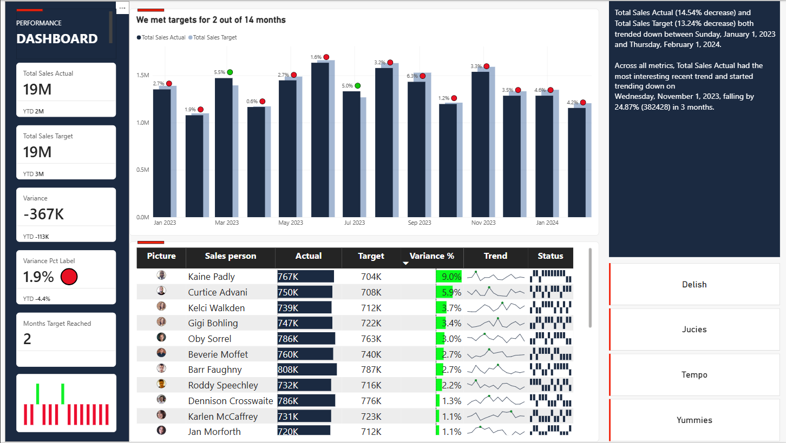

# Finance-Sales-KPI-Dashboard
### 1.	Project Title / Headline
📈 Finance Sales KPI Dashboard: Performance & Target Tracking
A dynamic, interactive data visualization tool built to track sales actuals versus targets, monitor monthly variance, and evaluate individual salesperson performance over a 14-month period.

### 2.	Short Description / Purpose
The Finance Sales KPI Dashboard is an analytical Power BI report designed to help sales managers and finance teams quickly evaluate business performance against set targets (Jan 2023 to Jan 2024). By highlighting critical KPIs such as total actuals, variance percentages, and individual win/loss trends, this tool enables data-driven decision-making and provides an immediate snapshot of team health and target attainment.

### 3.	Tech Stack
The dashboard was built using the following tools and technologies: 
•	📊 Power BI Desktop – Main data visualisation platform used for report creation. 
•	📂 Power Query – Data transformation and cleaning layer for reshaping and preparing the data. 
•	🧠 DAX (Data Analysis Expressions) – Utilised for calculating measures like Total Sales Actual, Total Sales Target, Variance, YTD values, Target Reached Month Count, conditionally formatting Emoji labels, and building dynamic chart titles. 
•	📝 Data Modeling – Connected two fact tables (Actual and Target) to two dimension tables (Calendar and People) for cross-filtering and aggregation. 
•	📁 File Format – .pbix for development and .png for dashboard previews.

### 4.	Data Source
Source: Custom finance data tables (associated with the "Awesome Chocolates" dataset) provided in Chandoo's Power BI tutorial.

**Tutorial Reference:** [Make an Incredible Finance KPI Dashboard with Power BI in 20 minutes](https://www.youtube.com/watch?v=i3AR0gt9SHA) on YouTube.

The data is structured across four tables:
- **Actual performance table:** Contains monthly sales achievements per salesperson.
- **Targets table:** Contains the monthly sales goals assigned to each salesperson.
- **Calendar Dimension:** A simplified date table (spanning 14 months, ending Feb 2024).
- **People Dimension:** Contains details about the salespeople and their respective teams (e.g., Delish, Jucies, Tempo, Yummies) and image URLs for table visuals.

### 5.	Features / Highlights
•	Business Problem
Financial and sales data is often maintained in giant, complex matrix-style pivot tables, making it difficult to analyse. 

Key questions such as:
How many months did we actually hit our targets?
Which salespeople are consistently performing well?
What is the overall year-to-date variance?
… are difficult to answer quickly with raw data.

•	Goal of the Dashboard
To deliver an interactive visual tool that:
Transforms raw matrix data into clear, actionable insights.
Allows leadership to track 14 months of historical sales actuals vs. targets at a glance.
Enables managers to filter and drill down into specific team and individual performance trends.

•	Walkthrough of Key Visuals
-	Key KPIs (Left Panel)
Total Sales Actual: 19M
Total Sales Target: 19M
Variance: (367K)
Variance Pct Label: 1.9% with a dynamic red indicator emoji
Clustered Column Chart for Months Target Reached: 2
*Includes Year-to-Date (YTD) reference labels for context
-	Win/Loss & Trend Chart (Center)
An overlapping column chart comparing actuals (strong color) and targets (faded, 50% transparent color). It features conditional formatting and a dynamic title ("We met targets for 2 out of 14 months") that automatically updates based on the selected team
- Smart Narrative (Top Right)
An automatically generated text box summarising key metric changes
- Team Slicers (Bottom Right)
Interactive filters allowing the user to slice the data by distinct teams: Delish, Jucies, Tempo, and Yummies.
- Detailed Salesperson Table (Bottom Center)
A comprehensive table showing individual rep data (Picture, Sales person, Actual, Target). It uses conditional formatting: Data bars for Variance %
Sparklines to visualise individual trend histories
Sparklines (column) for target win/loss status over time.

•	Business Impact & Insights
Performance Tracking: Leadership can instantly recognise that the overarching target was only met 2 out of 14 months, signaling a need for strategic adjustments. 
Sales Coaching: By looking at individual sparklines and variance percentages, managers can identify top performers (like Kaine Padly with a 9.0% positive variance) and reps needing support. 
Automated Reporting: Smart narratives and dynamic titles automate the storytelling process, dynamically pulling in text insights to save analysts time from having to manually write out monthly performance summaries.

### 6.	Screenshots / Demos

